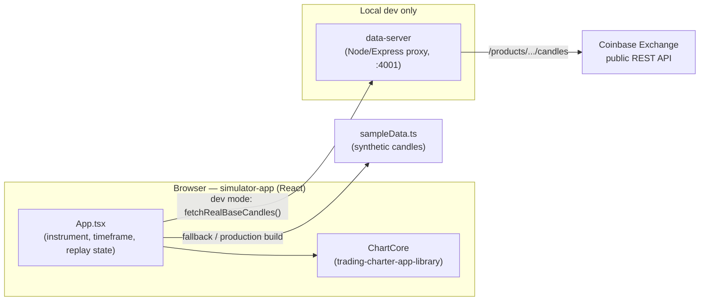

# Market Replay Trainer

A web app for practicing trading against real historical candles — play, pause, and step through the past bar-by-bar at adjustable speed, with a custom-built charting engine underneath. No future data ever leaks to the chart; you only ever see what a trader at that historical moment could have seen.

**Live demo:** https://sigaukecogitater.github.io/trading-simulator-app/ (runs on sample data — see [Real data vs. sample data](#real-data-vs-sample-data) below)

This repo currently ships the charting/replay core and a demo app around it. The fuller trading-simulator vision — simulated orders, account P&L, training challenges, session scoring — is written up in [`docs/requirements.md`](docs/requirements.md) and not yet built; see [`docs/ROADMAP.md`](docs/ROADMAP.md) for what's done, what's next, and how to help.

## What's in this monorepo

| Package | Path | What it is |
| --- | --- | --- |
| `trading-charter-app-library` | `src/trading-charter-app-library` | A dependency-free Canvas 2D charting engine, built from scratch: candlesticks, volume, crosshair, axes, a replay-driven update API, and a plugin seam for indicators and drawing tools. Framework-agnostic — nothing in it knows React exists. |
| `simulator-app` | `src/simulator-app` | The React demo shell around the library: instrument/timeframe picker, replay transport controls, drawing toolbar, settings panel. This is what the live demo above serves. |
| `data-server` | `src/data-server` | A small local Node/Express proxy that fetches real historical candles (currently from Coinbase Exchange's public API, crypto only) so the browser never has to talk to a market-data provider — or hold an API key — directly. |

Full write-up of how these fit together, with diagrams, in [`docs/ARCHITECTURE.md`](docs/ARCHITECTURE.md).

## Quick start

Requires Node 20+ and npm (this repo uses npm workspaces — one `npm install` at the root installs all three packages).

```bash
git clone https://github.com/SigaukeCogitater/trading-simulator-app.git
cd trading-simulator-app
npm install
npm run dev:simulator
```

Open the URL Vite prints (typically `http://localhost:5173`). That alone gets you the full app on **sample data** — synthetic but realistic-looking candles generated locally, no network calls, no setup. See [`docs/RUNNING_LOCALLY.md`](docs/RUNNING_LOCALLY.md) for the rest of the dev commands (running the real-data proxy, building for production, running the library's test suite) and for troubleshooting.

## Architecture at a glance



The deployed GitHub Pages build never talks to `data-server` at all (there's nowhere to host it yet) and runs on sample data only, by design — see [`docs/DATA_PROVIDERS.md`](docs/DATA_PROVIDERS.md).

## Real data vs. sample data

- **Sample data** — generated locally by `simulator-app`, always available, what the live demo runs on.
- **Real data** — currently just crypto (BTC/USD, ETH/USD, SOL/USD, LTC/USD), pulled live from Coinbase Exchange's public API through `data-server`, and only available when you run `data-server` yourself locally (`npm run dev:server`). No API key needed for this.
- **Forex and single stocks** (EUR/USD, AAPL in the instrument list) are there to demonstrate the "no real data yet" state honestly — they always show the Sample badge. Free, charting-grade intraday forex data in particular has been a real gap in what we've found so far; see [`docs/DATA_PROVIDERS.md`](docs/DATA_PROVIDERS.md) for what's been tried, what looks promising, and how to help find or wire up a source.

## Contributing

Contributions are very welcome — the charting library, the simulator, and the search for usable free market-data sources all have real open work. Start with [`CONTRIBUTING.md`](CONTRIBUTING.md).

## Roadmap

See [`docs/ROADMAP.md`](docs/ROADMAP.md) for what's built, what's next (a real trading/account simulation engine, forex data, publishing the charting library to npm on its own, and how `data-server` is expected to grow once real data covers more than crypto).

## Docs index

- [`docs/requirements.md`](docs/requirements.md) — the original product requirements spec (the full vision)
- [`docs/implementation-plan.md`](docs/implementation-plan.md) — the data-provider and chart-library research that shaped early decisions
- [`docs/ARCHITECTURE.md`](docs/ARCHITECTURE.md) — how the three packages fit together, with diagrams
- [`docs/RUNNING_LOCALLY.md`](docs/RUNNING_LOCALLY.md) — dev setup, all npm scripts, building for production, troubleshooting
- [`docs/DATA_PROVIDERS.md`](docs/DATA_PROVIDERS.md) — how real data works today, the forex/stocks gap, how to add a new provider
- [`docs/ROADMAP.md`](docs/ROADMAP.md) — what's next, and where `data-server` is headed

## License

[Apache License 2.0](LICENSE).
