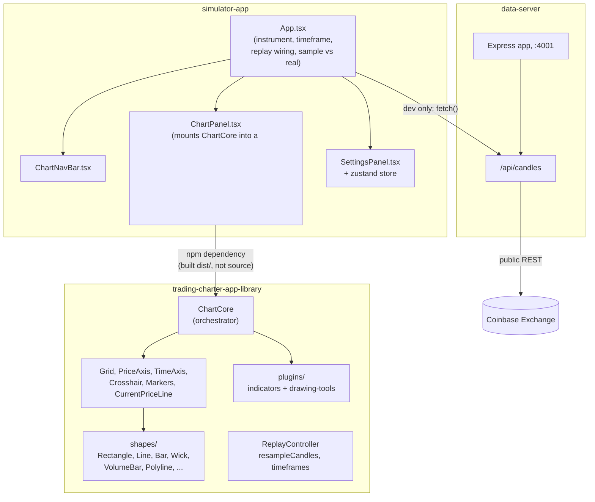
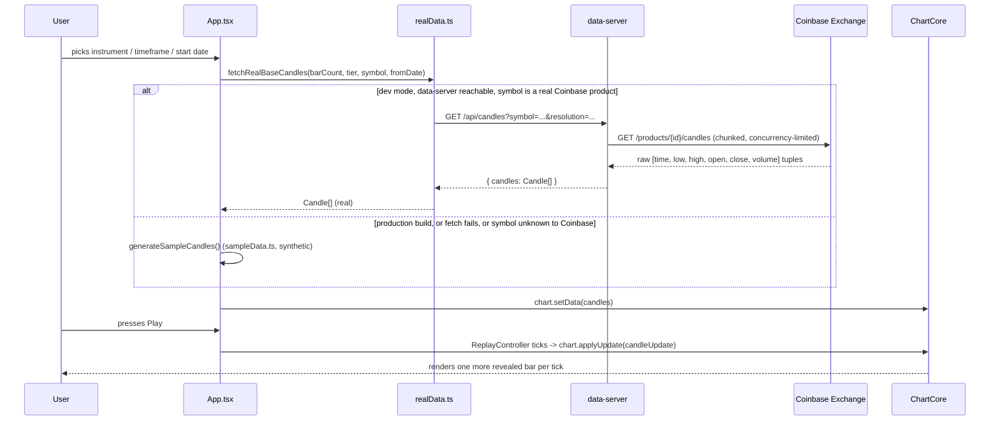
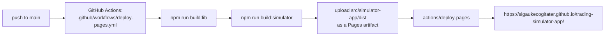

# Architecture

How the three packages in this monorepo fit together, and how a candle actually gets from a data source onto the screen.

## The three packages



**`trading-charter-app-library`** is a dependency-free Canvas 2D charting engine — no React import anywhere in it, no assumption about what framework (if any) hosts it. `ChartCore` is the orchestrator: it owns the canvas, the current candle buffer, pan/zoom/viewport state, and every render object (`Grid`, `PriceAxis`, `TimeAxis`, `Crosshair`, `Markers`, `CurrentPriceLine`), and exposes an imperative API (`setData`, `applyUpdate`, `resize`, `zoom`, `panByCandles`, `setActiveDrawingTool`, `registerIndicator`, `onRender`, …) rather than a React component API. That's a deliberate choice: `simulator-app` mounts one `ChartCore` per `<canvas>` in a `useEffect` and drives it directly, the same imperative-mount-then-drive pattern any Canvas-based chart uses regardless of host framework (see `docs/implementation-plan.md` §3.1 for the reasoning that shaped this).

**`simulator-app`** is the React shell: instrument/timeframe/date picker (`ChartNavBar`), the canvas host and replay wiring (`ChartPanel`, `App`), and a settings panel backed by a small Zustand store for chart colors/options. It depends on `trading-charter-app-library` as a real installed package — its `import`s resolve to the library's **built** `dist/index.js` (see `package.json`'s `"trading-charter-app-library": "^0.1.0"` dependency and the library's own `"main": "dist/index.js"`), not to TypeScript source. That's why `npm run build:lib` has to run before `npm run build:simulator` — see [Building](#building) below.

**`data-server`** is a thin, stateless Node/Express proxy — no database, no caching layer today. It exists for one reason: keeping any real-data API key server-side, out of browser-bundled code (see `docs/DATA_PROVIDERS.md` for the full reasoning and why this matters even for a demo project). It currently proxies Coinbase Exchange's public candle endpoint, which needs no key at all; a Finnhub key can optionally be set for its `/diagnose` and `/quote` routes, but no live candle data currently comes from Finnhub — see `docs/DATA_PROVIDERS.md`.

## How a candle reaches the chart



Two things worth calling out:

- **Two base series, not one.** `App.tsx` fetches (or generates) two independent base candle series — a fine tier (1-minute bars) and a coarse tier (1-hour bars) — and derives every timeframe the user can pick (1m/5m/15m/30m from the fine tier, 1h/3h/4h/8h/1D from the coarse tier) from whichever base series covers it, via `resampleCandles`. This avoids either asking a provider for every timeframe separately or resampling a single very-long fine-grained series just to get daily bars.
- **Production build never calls `data-server` at all.** `realData.ts`'s `fetchRealBaseCandles` returns `null` immediately when `import.meta.env.DEV` is false — i.e. for anything built with `vite build`, including the GitHub Pages deploy. There's nowhere to host `data-server` publicly yet, so the deployed site would only ever fail that fetch anyway (and, being HTTPS, would hit a mixed-content browser block trying to reach a bare `http://localhost:4001`) — this just skips the guaranteed-failing request instead of letting it fail on its own.

## Replay engine

`ReplayController` (in the library, framework-agnostic) drives playback independent of `ChartCore` — it's a cursor over a candle series plus a timer, not tied to any particular renderer. It ticks at `baseIntervalMs / speed / intrabarTicks`, calling back with `CandleUpdate` objects (`{ candle, index, final }`) that `App.tsx` forwards straight to `ChartCore.applyUpdate()`. `final: false` updates let a forming bar redraw in place; `final: true` locks it and starts the next. Speed changes (`setSpeed`) restart the timer at the new interval without an extra tick; `play()` fires one tick immediately (so pressing Play never feels like it's waiting out a full interval first) and guards against the timer resurrecting itself if that immediate tick happened to end the session and call `pause()`.

## Drawing tools plugin seam

Every drawing tool (`Trendline`, `HorizontalLine`, `VerticalLine`, `TraceLine`) implements the library's `DrawingTool` interface and extends the shared `BaseDrawingTool` abstract class, which handles the bookkeeping every tool needs identically (`id`, `points`, `selected`, `addPoint`, `isComplete`, `setPreviewPoint`) so a concrete tool only supplies `name`, `maxPoints`, `draw()`, and `hitTest()`. `ChartCore` never constructs a tool directly — `plugins/drawing-tools/factory.ts`'s `createDrawingTool(name)` does, keyed by `DrawingToolTypeName`, so adding a new tool means: implement it, register it in the factory, export it from the library's `index.ts`, and add a toolbar entry in `simulator-app`'s `ChartNavBar.tsx`.

Fixed-point tools (`HorizontalLine`, `VerticalLine`, `Trendline`) complete automatically once `points.length` reaches `maxPoints`. Tools with no natural fixed point count (`TraceLine`, which keeps adding connected segments click after click) instead implement the interface's optional `finish?(): void`, which `ChartCore`'s double-click, right-click, and two-finger-click handlers call to end placement explicitly — fixed-point tools simply don't define it, so those handlers (called via `?.`) are no-ops for them.

Indicators follow the same shape on a simpler interface (`Indicator`: `compute(candles) -> number[]`, plus a `pane` of `"main"` or `"aux"`), registered via `ChartCore.registerIndicator()`. Only `MovingAverage` exists today — see `CONTRIBUTING.md` for the indicator backlog.

## Building

```bash
npm run build:lib        # trading-charter-app-library -> dist/
npm run build:simulator  # simulator-app -> src/simulator-app/dist/ (needs build:lib first)
npm run build:site       # both, in the right order
```

`simulator-app`'s Vite config sets `base: "./"` specifically so the exact same build output works from any subpath — a plain local `vite preview`, a project's own domain, or a GitHub Pages project-page URL (`https://<user>.github.io/<repo>/`) — without a rebuild or a config change per target.

## Deploy pipeline (GitHub Pages)



The workflow triggers on every push to `main`, plus a manual `workflow_dispatch` (useful the first time Pages is turned on, or to redeploy without a new commit). It never builds or deploys `data-server` — the deployed site is sample-data-only by design, per the note above. See `docs/ROADMAP.md` for how that's expected to change once `data-server` has something worth deploying.

## What's deliberately not built yet

This repo implements the charting/replay core of the product described in `docs/requirements.md`, not the full spec. In particular there is currently **no** simulated trading engine (orders, positions, fills, P&L, account state — §4.3), no training modes (§4.5), no session analytics (§4.6), and no server-authoritative anti-cheat replay delivery (§6.2, NFR-3–NFR-5) — today's replay is entirely client-side, which is fine for a demo but not for the "future data must never be recoverable from the client" requirement the original spec treats as non-negotiable. See `docs/ROADMAP.md`.
